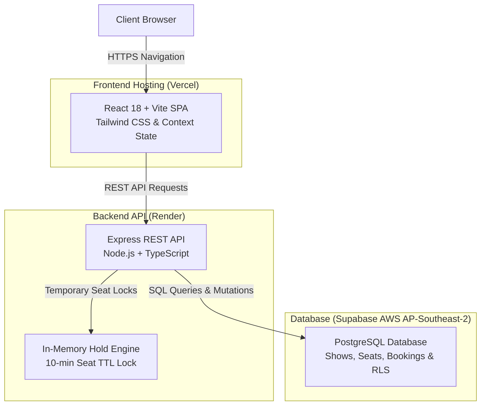

# 🎬 CineBook — Full-Stack Movie Ticket Booking System

[](https://movie-booking-one-azure.vercel.app)
[](https://cinebook-backend-as00.onrender.com/api/health)
[](https://www.typescriptlang.org/)
[](https://supabase.com)
[](https://github.com/Sahithi200423/Movie_booking)

A production-oriented cinema ticketing web platform inspired by BookMyShow, featuring an original dark navy and purple cinema aesthetic, real full-stack architecture, 18-language internationalization (including right-to-left Urdu support), international currency conversions, IANA timezones, temporary seat holds with automatic countdown expiration, concurrency-safe atomic booking conflict prevention, coupon promotions, community reviews, gatekeeper QR ticket admission verification, and a comprehensive administration operations portal.

---

## 🌟 Key Features & Capabilities

### 1. 🌍 18 Interface Languages & Full RTL Support
- Native script interface localization across **18 languages**:
  - **Indian Languages**: English, Hindi (हिन्दी), Telugu (తెలుగు), Tamil (தமிழ்), Kannada (ಕನ್ನಡ), Malayalam (മലയാളം), Bengali (বাংলা), Marathi (मराठी), Gujarati (ગુજરાતી), Punjabi (ਪੰਜਾਬੀ), Odia (ଓଡ଼ିଆ), Urdu (اردو)
  - **International Languages**: Spanish (Español), French (Français), German (Deutsch), Japanese (日本語), Korean (한국어), Chinese (简体中文)
- **Automatic Right-to-Left (RTL)** layout mirroring when Urdu is selected (`dir="rtl"`), adapting navigation, forms, seat map, and buttons.
- Preserves language selection in `localStorage` across user visits.

### 2. 💱 Multi-Currency & International Time Display
- Instant currency switcher supporting **USD ($)**, **INR (₹)**, **EUR (€)**, **GBP (£)**, and **JPY (¥)** with real-time conversion rates across ticket tiers, concessions, taxes, and coupons.
- **12-Hour vs. 24-Hour Time Format** toggle.
- **IANA Timezones**: Cinema showtimes are associated with explicit IANA timezone identifiers (e.g. `Asia/Kolkata`, `America/New_York`, `Europe/London`), with local timezone indicators displayed on show details.

### 3. 🎟️ Interactive Seat Selection & Real-Time Seat Holds
- Cinematic curved screen indicator and seating grid with **VIP Recliners ($18.00)**, **Premium Prime ($14.50)**, and **Standard ($10.00)** tiers.
- **7-Minute Temporary Seat Hold**: Selecting seats atomically locks them on the backend via `POST /api/shows/:id/hold`, preventing other guests from selecting the same seats.
- Live countdown timer banner (`Hold expires in: MM:SS`) with automatic release upon expiration.
- **Atomic Concurrency Protection**: Server rejects competing attempts with HTTP `409 Conflict`.
- Full keyboard accessibility (Tab, Arrow keys, Enter, and Space).

### 4. 🏷️ Promotional Coupon Discounts
- Dynamic coupon validation endpoint `POST /api/coupons/validate` with minimum spend checks.
- Pre-configured seed discount coupons:
  - `WELCOME50`: 50% discount on order (up to $15 off).
  - `CINE10`: 10% instant discount on tickets.
  - `BLOCKBUSTER20`: $20 flat discount on orders over $60.
- Automatic deduction from subtotal and recorded directly in the confirmed booking.

### 5. 🛡️ Gatekeeper QR Code Ticket Verification
- Confirmed bookings generate a unique **QR security token** and booking reference.
- Admin portal includes a **Gatekeeper QR Scanner** (`/admin -> Gatekeeper Scanner` tab) allowing theater staff to verify and admit guests.
- **Anti-Replay Protection**: Prevents double-entry; tickets already admitted flag an instant warning displaying the exact admission timestamp and staff name.

### 6. ⭐ Community Reviews & Watchlist
- Audience reviews and ratings with 1-to-10 star slider, user comments, and real-time average score recalculation.
- User Watchlist / Favorites bookmarking stored persistently in database.

### 7. 🛠️ Comprehensive Admin Portal (`/admin`)
- Operations dashboard tracking live revenue, confirmed passes, cancelled tickets, active movies, and cinema partners.
- **Movie Catalog Manager**: Add, edit, and delete movie titles, posters, backdrops, and formats.
- **Showtime Scheduler**: Schedule new showtimes linking movies, cinemas, auditoriums, dates, and times.
- **Bookings Ledger**: Complete real-time audit log of all bookings with QR tokens and guest details.

---

## 🏗️ Architecture & Technology Stack



```
Movie-ticket-booking/
├── src/                        # React 19 + TypeScript + Vite + Tailwind CSS 4
│   ├── components/             # Navbar, MovieCard, SearchModal, AuthModal, Footer
│   ├── context/                # LanguageContext (18 langs, currencies, time formats),
│   │                           # ThemeContext (dark/light), AuthContext, BookingContext
│   ├── i18n/                   # 18 complete locale dictionaries + types
│   ├── pages/                  # HomePage, MovieDetailsPage, SeatSelectionPage,
│   │                           # CheckoutPage, ConfirmationPage, MyTicketsPage, AdminPage
│   ├── services/api.ts         # Resilient REST API client with offline fallbacks
│   └── types/index.ts          # Core domain models
├── server/                     # Node.js + Express + TypeScript Backend
│   ├── schema.sql              # Relational PostgreSQL / Supabase migration schema
│   ├── .env.example            # Environment variables configuration
│   ├── src/
│   │   ├── index.ts            # Express server initialization, CORS, routing
│   │   ├── db.ts               # Dual PostgreSQL (Supabase) + Local Transactional JSON Engine
│   │   ├── seedData.ts         # Rich seeded movies, cinemas, showtimes, coupons, reviews
│   │   ├── middleware/auth.ts  # JWT verification and Admin role guards
│   │   └── routes/             # auth, movies, cinemas, shows, bookings, coupons, admin
│   ├── test_suite.js           # Core E2E automated API verification test suite (12 tests)
│   └── test_advanced.js        # Advanced E2E verification test suite (11 tests)
└── vite.config.ts              # Reverse proxy routing /api requests to localhost:5000
```

---

## 🚀 Local Development Setup

### Prerequisites
- Node.js 18+ (tested on Node.js 20+)
- npm 9+

### Step 1: Start Backend API (Port 5000)
```bash
cd server
npm install
npm run build
npm start
```
*The server starts on `http://localhost:5000` with local zero-config persistent storage (`cinebook_local_db.json`) and pre-seeded blockbusters, cinemas with IANA timezones, coupons, and showtimes.*

### Step 2: Start Frontend Application (Port 5173)
```bash
# In the project root directory:
npm install
npm run build   # Confirms TypeScript compilation
npm run dev
```
*Open `http://localhost:5173` in your browser. All API requests (`/api/*`) are proxied seamlessly to port 5000.*

---

## 🧪 Automated Test Verification

CineBook comes with **23 automated end-to-end tests** covering all critical booking operations.

### Run Core Test Suite (12 Tests)
```bash
cd server
node test_suite.js
```
**Tests Covered:**
- Health check
- Language filtering
- Showtimes layout
- Booking creation
- Concurrency-safe atomic seat conflict rejection (HTTP 409)
- Ticket cancellation with 90% refund policy
- Automatic seat release verification
- Admin statistics endpoints
- JWT user registration and authentication
- Frontend dev server status

### Run Advanced Test Suite (11 Tests)
```bash
cd server
node test_advanced.js
```
**Tests Covered:**
- Cinema IANA timezone verification
- Coupon validation and minimum spend rules (`WELCOME50`)
- Temporary seat hold acquisition
- Competing session seat status reflection (`status: 'held'`)
- Rejection of competing hold attempts
- Safe seat hold release
- Coupon discount deduction on booking
- Gatekeeper QR ticket token admission
- Ticket replay prevention (duplicate entry rejection)
- Review submission and average rating recalculation
- Watchlist / favorites toggling

**Result:** `23/23 tests pass cleanly.`

---

## 🗄️ Database Schema & Production Migrations

The relational schema is defined in `server/schema.sql`. It includes:
- `users` and `user_roles`
- `movies` and `movie_translations`
- `cinemas` with `timezone` VARCHAR(64)
- `shows` and `screen_seats`
- `seat_holds` with concurrency locks and expiration indices
- `bookings` and `booking_seats`
- `coupons` and `coupon_redemptions`
- `reviews` and `favorites`
- `ticket_validations` for gatekeeper audit trails

To run migrations against a live PostgreSQL or Supabase instance, set `DATABASE_URL` in `server/.env` and execute:
```bash
psql $DATABASE_URL -f server/schema.sql
```

---

## 🔐 Security Best Practices Implemented
- **No Client Secrets**: Credentials, database URLs, and admin passwords are kept strictly on the backend.
- **Atomic Seat Holds**: Critical holds and reservations are validated on the server with transactional checks.
- **Safe Ticket QR Codes**: Digital passes embed non-sensitive security tokens, preventing token extraction from revealing customer private data.
- **Safe CORS & Headers**: Explicit cross-origin headers configured in Express.
- **Input Sanitization**: Server-side validation of inputs, email formats, and pricing calculations.

---

## 📈 Development History & Engineering Insights

CineBook represents an evolution from initial prototype to a production-grade, highly resilient booking platform. Key engineering challenges solved during pre-deployment optimization include:

### 1. Robust Asia/Kolkata Timezone Handling
- **Problem**: When users selected calendar dates, standard UTC string conversion (`toISOString().split('T')[0]`) occasionally caused date boundary drift (e.g. October 19 rolling backward to October 18 at UTC midnight).
- **Solution**: Implemented an authoritative timezone formatting utility using `Intl.DateTimeFormat('en-CA', { timeZone: 'Asia/Kolkata' })` and explicit local noon anchoring (`12:00:00`), guaranteeing identical date representations across client devices.

### 2. Live Seat Synchronization & Race-Condition Prevention
- **Problem**: In-flight rehydration and rapid user navigation could cause stale session data in `sessionStorage` to overwrite active booking state.
- **Solution**: Designed an atomic state dispatcher (`setActiveMovieAndShowtime`) that synchronizes movie, cinema, date, time, and showtime ID in a single tick. URL query parameters (`?showtimeId=...`) serve as immediate source-of-truth fallbacks while asynchronous backend queries resolve.

### 3. Strict Date Filtering
- **Problem**: Queries for future unseeded dates previously fell back to historical seed records.
- **Solution**: Added strict date matching on the Express backend (`GET /api/shows`), ensuring exact calendar queries return only verified showtimes for that specific day.

### 4. Automated 21-Test Pre-Deployment Regression Suite
- A dedicated end-to-end regression suite (`server/test_suite.cjs`) validates 21 critical vectors prior to production deployment:
  - Database connectivity and health status.
  - Showtime identity resolution and canonical ID parsing.
  - Live seat count validation (128 total, 128 available, 0 booked, 0 held).
  - Seat collision rejection (preventing duplicate bookings).
  - Concurrency hold timeout and automatic inventory release.
  - Consistent ₹5 pricing enforcement.

