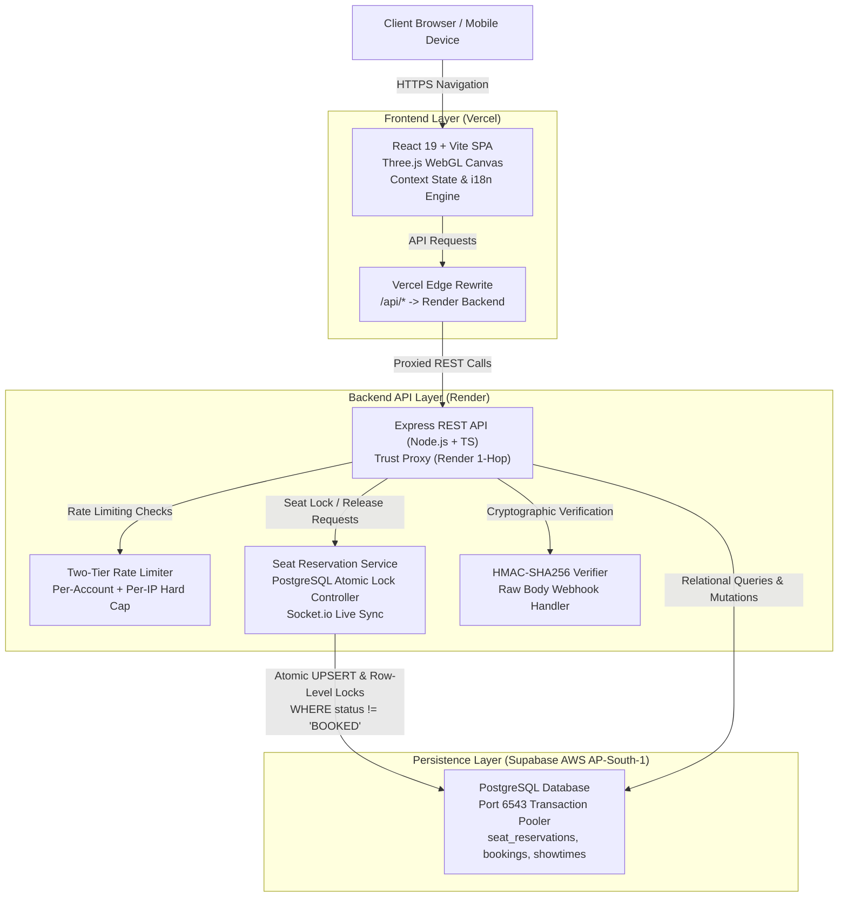

# 🎬 CineBook V3 — Full-Stack Cinema Ticketing & Reservation Platform

[](https://movie-booking-one-azure.vercel.app/)
[](https://cinebook-backend-as00.onrender.com/api/health)
[](https://www.typescriptlang.org/)
[](https://react.dev/)
[](https://supabase.com/)
[](https://github.com/Sahithi200423/Movie_booking)

> A full-stack cinema ticketing portfolio application featuring an interactive **Three.js floating 3D ticket hero**, high-concurrency **PostgreSQL-backed atomic seat locking with race-condition prevention**, **₹5 demo pricing**, **18-language internationalization** (including full RTL Urdu support), and **tamper-resistant digital M-tickets** with QR gate admission.

---

## 📌 Executive Summary

CineBook V3 is a full-stack cinema booking and auditorium management application inspired by industry platforms like BookMyShow and AMC Theatres. Built with **React 19, TypeScript, Three.js, Express, and Supabase PostgreSQL**, the platform showcases end-to-end engineering excellence: from client-side WebGL rendering to backend concurrency locks, proxy anti-spoofing, and webhook idempotency.

* **Live Frontend:** [https://movie-booking-one-azure.vercel.app/](https://movie-booking-one-azure.vercel.app/)
* **Live Backend API:** [https://cinebook-backend-as00.onrender.com](https://cinebook-backend-as00.onrender.com)
* **GitHub Repository:** [https://github.com/Sahithi200423/Movie_booking](https://github.com/Sahithi200423/Movie_booking)

> [!NOTE]
> **Free-Tier Backend Notice:** The backend is hosted on a free-tier Render web service. After periods of inactivity, the server will enter sleep mode. The first request may take 20–45 seconds to spin up. All subsequent interactions are instant.

---

## 🏛️ System Architecture



---

## 🚀 Key Features

### 1. 🎟️ Interactive Floating 3D Ticket Hero
* **Three.js WebGL Animation:** Features a realistic golden/metallic cinema pass rendered dynamically on the homepage.
* **Autonomous Gentle Physics:** Floats smoothly with an 8–12px vertical sine oscillation over a 5-second cycle.
* **Capped Motion Bounds:** Automatic tilt and desktop mouse parallax are strictly capped between **10° and 15°** (pitch/yaw), preventing disorienting 360° spin disruptions.
* **Mobile-Optimized Touch:** Touch drag gestures are decoupled from page scroll, ensuring smooth native mobile scrolling.
* **Performance Guard (`IntersectionObserver`):** When the hero is scrolled off-screen, the GPU animation loop pauses automatically, saving mobile battery and CPU cycles. Accessible fallback for users with `prefers-reduced-motion`.

### 2. 💺 128-Seat Interactive Auditorium & Atomic Holds
* **Cinema Layout:** 128 seats arranged across 8 rows (`A` through `H`) and 16 columns.
* **Curated Seating Tiers:**
  * **VIP Recliner Lounges:** Rows A & B (Front view, extra legroom)
  * **Premium Prime:** Rows C, D & E (Center acoustic sweet-spot)
  * **Standard Classic:** Rows F, G & H (Upper cinema seating)
* **10-Minute Temporary Seat Hold:** When a customer selects seats, atomic conditional locks are acquired directly in PostgreSQL (`seat_reservations` table via conditional `INSERT ... ON CONFLICT DO UPDATE WHERE status != 'BOOKED' AND ...`) with an exact 600,000 ms TTL.
* **Live Countdown Timer:** An in-auditorium countdown banner (`Hold expires in: MM:SS`) keeps the customer informed.
* **Anti-Double-Booking Protection:** Competing sessions attempting to lock an already held seat immediately receive an HTTP `409 Conflict` via atomic database-level conflict detection.
* **Automatic Expiration & Cleanup:** If checkout is not completed within 10 minutes, the lock expires automatically, and seats return to available inventory.
* **8-Seat Transaction Cap:** Enforces a maximum of 8 seats per booking transaction on both frontend and backend.

### 3. 💰 Uniform ₹5 Demo Pricing
* Every seat in the auditorium—regardless of tier (VIP, Premium, or Standard)—is priced at **₹5.00** for demonstration purposes.
* Pricing is computed and enforced strictly by the backend server; client-side price tampering is completely prevented.

### 4. 💳 Razorpay Payment Flow (Sandbox/Test Mode)
* **Server-Side Order Creation:** Orders are created via `razorpay.orders.create({ amount: totalInPaise, currency: "INR", receipt })`. For example, a 1-seat ticket is calculated as exactly 500 paise (₹5.00), and an 8-seat booking is 4000 paise (₹40.00).
* **HMAC-SHA256 Cryptographic Verification:** Client callback signatures (`razorpay_order_id`, `razorpay_payment_id`, `razorpay_signature`) are verified using timing-safe comparisons (`crypto.timingSafeEqual`).
* **Webhook Hardening & Idempotency:**
  * Webhook signatures use the raw request byte buffer (`req.rawBody`) to prevent serialization differences.
  * Duplicate `payment.captured` webhooks return `200 ALREADY_PROCESSED` without creating duplicate bookings.
  * Out-of-order `payment.failed` webhooks cannot cancel an already confirmed successful booking.
  * Tampered payment amounts or mismatched currencies return HTTP `400 Bad Request`.
* **Current Gateway Status:** Configured with test/sandbox credentials. No real monetary transactions or real debit/credit card charges occur.

### 5. 🎫 Digital M-Ticket & QR Gatekeeper Verification
* **Tamper-Resistant M-Tickets:** Each confirmed booking generates a unique alphanumeric reference (e.g., `CB-W5R6-DIKH`) and a 64-character SHA-256 digital security token embedded into an SVG QR code.
* **Gatekeeper Turnstile Scanner:** Cinema staff can scan tickets in the Admin Portal (`/admin -> Gatekeeper Scanner`).
* **Anti-Replay Protection:** Once a ticket is admitted, subsequent scan attempts flag an immediate warning with the exact entry timestamp and terminal ID.

### 6. 🔄 Cancellation Policy & Refund Reconciliation
* **Eligibility Rule:** Self-service cancellation is permitted up to **2 hours prior** to the scheduled showtime.
* **Seat Inventory Restoration:** Cancelled seats are immediately returned to available status for other moviegoers.
* **Transparent Refund Tracking:** The database explicitly differentiates between a **refund-required obligation** (`refundFlagged: true`) and an **actually executed gateway refund transaction** (`gatewayRefundId`). CineBook does not claim an automated bank refund has finished unless confirmed by gateway settlement.
* **Past Shows:** Shows under 2 hours or in the past are non-refundable.

### 7. 🌍 18 Languages & Full Right-to-Left (RTL) Support
* Native translations across **18 languages**:
  * **Indian Languages:** English, Hindi, Telugu, Tamil, Kannada, Malayalam, Bengali, Marathi, Gujarati, Punjabi, Odia, Urdu
  * **International Languages:** Spanish, French, German, Japanese, Korean, Chinese
* **Automatic RTL Layout Mirroring:** Selecting Urdu triggers `dir="rtl"` layout transformation, reversing navigation bars, modals, seat grids, and action buttons.

---

## 🛡️ Security Hardening & Bot Protection

The CineBook V3 backend includes dedicated production security controls designed specifically for cloud hosting environments:

| Security Vector | Implementation Detail | Protection |
|---|---|---|
| **Reverse Proxy IP Resolution** | `app.set('trust proxy', 1)` in Express | Accurately extracts client IP from Render's trusted 1-hop proxy. |
| **Header Anti-Spoofing** | Strips unverified prefixes; ignores arbitrary `CF-Connecting-IP` | Prevents attackers from bypassing rate limits by prepending fake IPs. |
| **Two-Tier Auth Limiting** | Tier 1: 15 attempts / 15m per account<br>Tier 2: 50 attempts / 15m per IP hard cap | Blocks credential stuffing even if the attacker cycles target email addresses. |
| **Two-Tier Seat Limiting** | Tier 1: 60 calls / min per session<br>Tier 2: 120 calls / min per IP hard cap | Prevents automated bots from rotating session IDs to lock entire auditoriums. |
| **Payment Order Cap** | 20 orders / 10m per session; 40 orders / 10m per IP | Stops bot spam from creating thousands of dangling gateway orders. |
| **Raw Buffer Webhooks** | `express.json({ verify: (req, _res, buf) => { req.rawBody = buf; } })` | Eliminates HMAC signature mismatch caused by JSON whitespace mutations. |
| **Post-Expiry Conflict** | Checks for newly acquired seat ownership before confirming late payments | Prevents double bookings; flags late payments as `FAILED` for refund reconciliation with HTTP 409. |
| **Production Sandbox Isolation** | In `NODE_ENV === 'production'`, `isSandbox` is strictly `false` | Explicitly rejects mock bypass signatures (`whsec_valid_mock_signature`) in production. |

---

## 🛠️ Technology Stack

```
Frontend:
  ├── React 19 (Hooks, Context API, Suspense)
  ├── TypeScript 5.x
  ├── Vite (Lightning-fast build tool)
  ├── Three.js (WebGL 3D metallic ticket hero)
  ├── Tailwind CSS 4 (Custom dark cinema theme)
  └── Lucide React (Accessible SVG icons)

Backend:
  ├── Node.js v20.18.0 & Express 4
  ├── TypeScript (Strict type safety)
  ├── Prisma ORM 5.22.0
  ├── PostgreSQL (`pg` connection pool with SSL)
  ├── express-rate-limit (IETF draft-7 standard headers)
  ├── Socket.io (Real-time seat reservation broadcasts)
  ├── bcryptjs & jsonwebtoken (Secure auth & session management)
  └── Razorpay Node SDK (Gateway order creation)

Cloud Infrastructure:
  ├── Frontend Hosting: Vercel (Global Edge Network)
  ├── Backend Hosting: Render Web Service (Ubuntu Linux container)
  └── Relational Database: Supabase PostgreSQL (AWS ap-south-1 Mumbai)
```

---

## 📸 Screenshots & UI Showcase

The repository organizes application screenshots inside the [`docs/screenshots/`](file:///c:/Users/MI/Desktop/CineBook-v2/docs/screenshots) directory:

| Screenshot | Description | Preview |
|---|---|:---:|
| `01_hero_3d_ticket_desktop.png` | Three.js floating 3D CineBook ticket hero on desktop | [View Screenshot](docs/screenshots/01_hero_3d_ticket_desktop.png) |
| `02_hero_3d_ticket_mobile.png` | Responsive 3D ticket hero rendered on mobile viewport | [View Screenshot](docs/screenshots/02_hero_3d_ticket_mobile.png) |
| `03_homepage_desktop_1440px.png` | Full desktop homepage with movie grid and search filters | [View Screenshot](docs/screenshots/03_homepage_desktop_1440px.png) |
| `04_mobile_responsive_view.png` | Mobile layout showing navigation, languages, and cards | [View Screenshot](docs/screenshots/04_mobile_responsive_view.png) |
| `05_3d_tilt_interaction.png` | Capped tilt interaction with specular metallic lighting | [View Screenshot](docs/screenshots/05_3d_tilt_interaction.png) |
| `06_android_mobile_view.png` | Native Android Chrome rendering verification | [View Screenshot](docs/screenshots/06_android_mobile_view.png) |

> [!TIP]
> **Additional Visual Assets Recommended for Live Capture:**
> - `07_seat_selection_128_layout.png`: Interactive 128-seat auditorium with VIP/Premium/Standard tiers and 10-minute hold countdown.
> - `08_checkout_order_summary.png`: Checkout breakdown displaying server-side ₹5 pricing and payment options.
> - `09_confirmed_mticket_qr.png`: Digital M-ticket pass with signed QR code.
> - `10_admin_operations_dashboard.png`: Admin portal with real-time stats and Gatekeeper QR scanner.

---

## 📈 Evolution: V1 → V2 → V3

```
┌────────────────────────┐      ┌────────────────────────┐      ┌────────────────────────┐
│      CineBook V1       │      │      CineBook V2       │      │      CineBook V3       │
│  (Prototype / Client)  │ ───> │  (Full-Stack Connect)  │ ───> │ (Security-Hardened App)│
│                        │      │                        │      │                        │
│ • Mock in-memory state │      │ • Express REST backend │      │ • Three.js 3D ticket   │
│ • Static movie cards   │      │ • Supabase PostgreSQL  │      │ • Proxy anti-spoofing  │
│ • Client-only checkout │      │ • 18-language i18n/RTL │      │ • Two-tier rate limits │
│ • No seat locks        │      │ • 128-seat auditorium  │      │ • Webhook idempotency  │
│ • Basic CSS styles     │      │ • Real M-Ticket QR     │      │ • 43 automated tests   │
└────────────────────────┘      └────────────────────────┘      └────────────────────────┘
```

1. **Version 1 (Frontend Prototype):** Built as an initial React SPA to demonstrate UI concepts, movie search, and basic seat layout with client-side state.
2. **Version 2 (Full-Stack Architecture):** Connected to a live Node.js/Express backend and Supabase PostgreSQL. Added relational schema migrations, 18-language internationalization, multi-currency conversion, coupon discounts, and digital QR ticket verification.
3. **Version 3 (Security Hardening & Visual Experience):**
   - Engineered the interactive Three.js 3D floating metallic ticket hero with physics bounds and mobile touch isolation.
   - Deployed comprehensive rate limiting, IP anti-spoofing, and bot protection behind Render's reverse proxy.
   - Hardened payment webhooks with raw buffer HMAC validation, event idempotency, and post-expiry conflict resolution.
   - Expanded automated test coverage across security, concurrency, and booking flows (**43/43 tests passing**).

---

## 🤖 AI-Assisted Development Disclosure

In accordance with modern software engineering practices, this project utilized **AI-assisted pair-programming tools** (Antigravity AI / Google DeepMind coding agents). 

* **Where AI was leveraged:** Rapid initial boilerplate scaffolding, generating comprehensive locale dictionaries for 18 languages, generating synthetic test fixtures, and constructing automated regression test matrices.
* **Where human engineering directed the project:** Architecture design, relational database schema modeling, business logic rules (10-minute seat hold TTL, post-expiry conflict resolution, prorated refund math), security hardening strategy (proxy IP extraction, two-tier rate limiting), manual code reviews, and end-to-end deployment verification on Vercel and Render.

---

## 🧪 Automated Test Suites (43/43 Passing)

CineBook includes two comprehensive automated test suites:

### 1. Security & Bot Hardening Suite (`test_security_hardening.js`) — 23 Tests
Validates proxy isolation, anti-spoofing, two-tier IP hard caps, webhook HMAC verification, and idempotency:
```bash
cd server
node test_security_hardening.js
# Output: 🎉 SECURITY SUITE RESULTS: 23/23 TESTS PASSED (100%)
```

### 2. End-to-End Booking & Verification Suite (`test_portfolio_ready_verification.js`) — 20 Tests
Validates multi-seat booking calculations (1, 4, and 8 seats), ₹5 server-side pricing, 10-minute hold expiration, cancellation eligibility, and M-ticket QR generation:
```bash
cd server
node test_portfolio_ready_verification.js
# Output: 🎉 VERIFICATION RESULTS: 20/20 TEST SUITES PASSED (100%)
```

---

## 💻 Local Installation & Setup

### Prerequisites
* Node.js v18+ (Node.js v20+ recommended)
* npm v9+

### 1. Clone the Repository
```bash
git clone https://github.com/Sahithi200423/Movie_booking.git
cd Movie_booking
```

### 2. Backend Setup
```bash
cd server
npm install

# Configure environment variables (a template is provided)
cp .env.example .env

# Build and start the backend
npm run build
npm start
```
*The backend server will start on `http://localhost:5000` with local persistent JSON fallback storage if PostgreSQL is not connected.*

### 3. Frontend Setup
```bash
# Open a new terminal in the project root
npm install

# Start Vite development server
npm run dev
```
*Open `http://localhost:5173` in your browser. All API requests (`/api/*`) are proxied automatically to port 5000.*

---

## 📋 Portfolio Evaluation & Production Roadmap

### For Evaluators & Recruiters:
The application is **fully configured for portfolio demonstration and interactive review**. Evaluators can:
1. Visit [https://movie-booking-one-azure.vercel.app/](https://movie-booking-one-azure.vercel.app/).
2. Experience the interactive floating 3D ticket hero.
3. Click **Demo Login** in the navigation bar to log in instantly as a user or administrator.
4. Select a movie, pick seats in the 128-seat auditorium, observe the 10-minute countdown, and proceed through checkout to receive a verified digital M-ticket.

### For Commercial Real-Money Launch:
1. **Live Payment Keys:** Transition `RAZORPAY_KEY_ID` and `RAZORPAY_KEY_SECRET` from test credentials (`rzp_test_...`) to live merchant credentials.
2. **Webhook Endpoint Activation:** Register `https://cinebook-backend-as00.onrender.com/api/payment/verify-webhook` in the Razorpay dashboard with `RAZORPAY_WEBHOOK_SECRET`.
3. **Database Pro Upgrade:** Upgrade Supabase to the Pro tier ($25/mo) to enable automated daily backups, 7-day retention, and Point-in-Time Recovery (PITR).
4. **Legal Compliance:** Publish finalized Terms of Service, Privacy Policy, and Refund/Cancellation documentation for payment aggregator merchant approval.

---

## 📄 License

An open-source license has not yet been attached to this repository. All rights reserved by the author. An open-source license (such as MIT) may be added in a future release.
