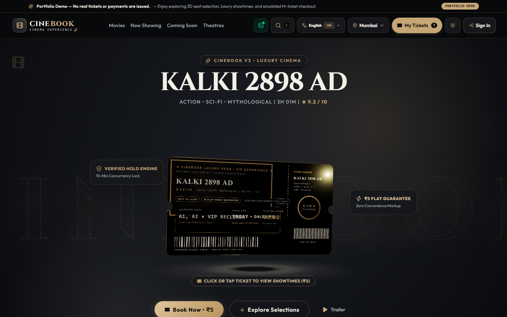
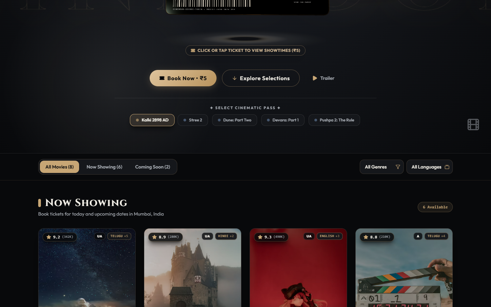
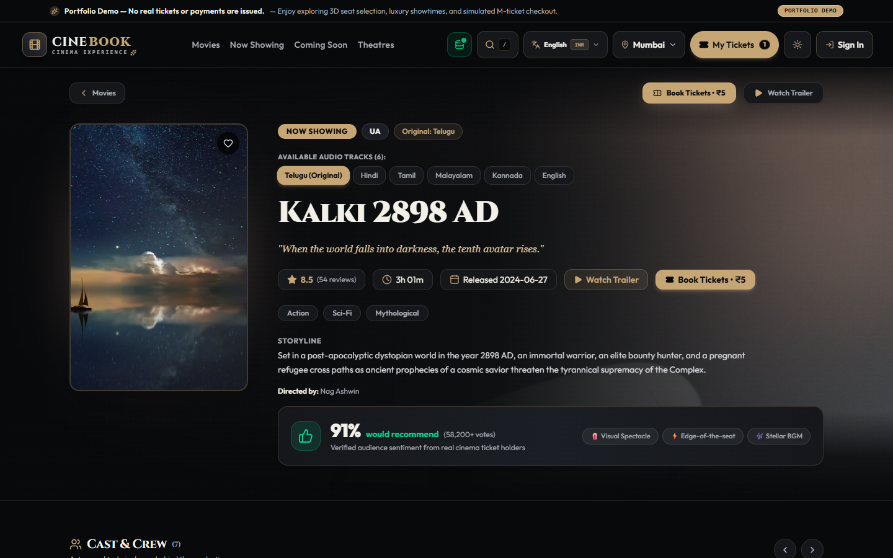
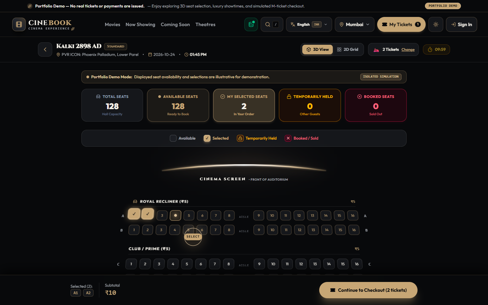
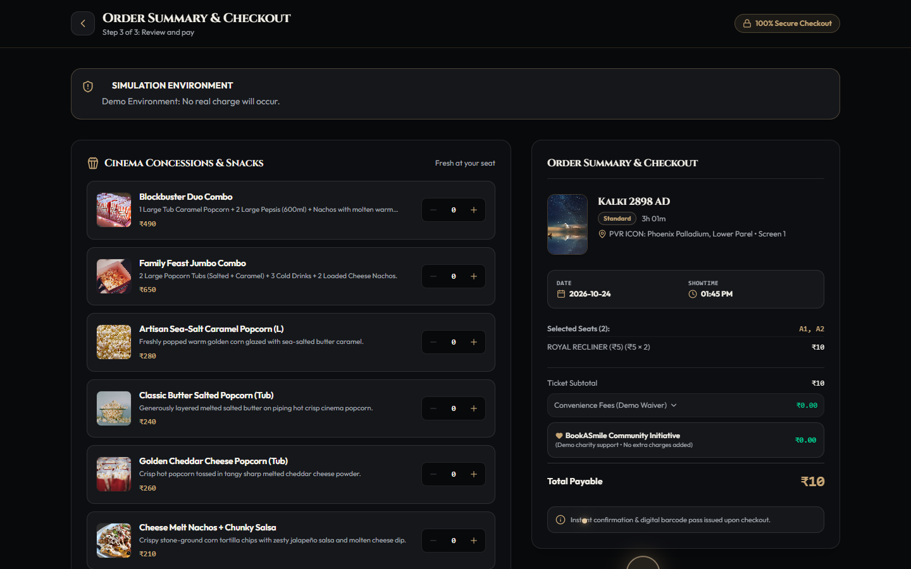
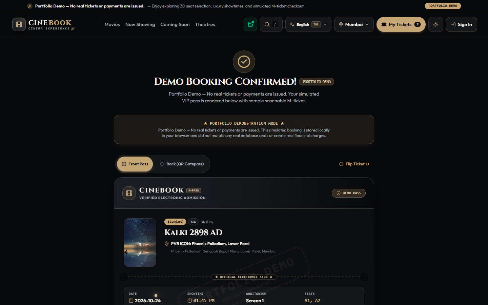
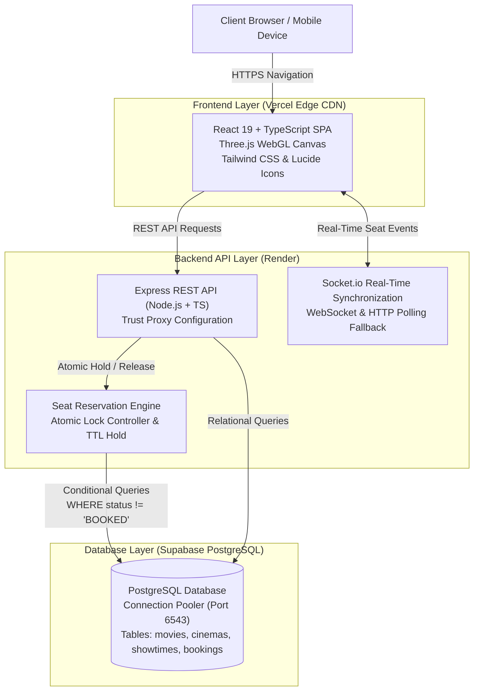

# 🎬 CineBook V3 — Full-Stack Cinema Reservation & Ticketing Platform

[](https://cinebook-v3.vercel.app/)
[](https://github.com/Sahithi200423/Movie_booking)
[](https://www.typescriptlang.org/)
[](https://react.dev/)
[](https://threejs.org/)
[](https://cinebook-backend-as00.onrender.com/api/health)
[](https://supabase.com/)

> **A luxury black-and-gold full-stack cinema booking application featuring an interactive 3D WebGL floating movie pass, real-time 128-seat auditorium map, atomic seat hold concurrency, simulated ₹5 demo checkout, and digital M-ticket generation.**

---

## 🌐 Live Application Links

* **Live Production Website:** [https://cinebook-v3.vercel.app/](https://cinebook-v3.vercel.app/)
* **Backend API Health Check:** [https://cinebook-backend-as00.onrender.com/api/health](https://cinebook-backend-as00.onrender.com/api/health)
* **GitHub Repository:** [https://github.com/Sahithi200423/Movie_booking](https://github.com/Sahithi200423/Movie_booking)

> [!NOTE]
> **Free-Tier Render Backend Notice:** The backend service is hosted on Render's free tier. After 15 minutes of inactivity, Render puts the service into sleep mode. The very first API request may experience a 20–35 second cold start while the container spins up. All subsequent interactions are instant.

---

## 📸 Production Screenshots

| 1. Homepage & 3D Floating Ticket | 2. Movie Catalog & Filtering |
| :---: | :---: |
|  |  |
| *Luxury black-and-gold aesthetic with dynamic 3D ticket pass* | *Multi-genre, multi-language movie discovery* |

| 3. Movie Details & Showtime Selection | 4. 128-Seat Interactive Auditorium |
| :---: | :---: |
|  |  |
| *Backdrop parallax, trailer preview, and real-time showtimes* | *VIP, Premium, and Standard seating with ₹5 demo pricing* |

| 5. Simulated Demo Checkout Form | 6. Digital M-Ticket Confirmation |
| :---: | :---: |
|  |  |
| *Demonstration order summary with ₹5 ticket calculation* | *Instant scannable M-ticket with security QR & demo watermark* |

---

## 📌 Project Overview

**CineBook V3** is a full-stack cinema ticketing web application designed to deliver an end-to-end booking experience inspired by modern entertainment platforms like BookMyShow and AMC Theatres. Built with a curated black-and-champagne-gold interface, the application bridges client-side WebGL rendering with a robust Node.js/Express backend and Supabase PostgreSQL persistence.

The project demonstrates:
1. **Interactive 3D WebGL Graphics:** Smooth Three.js ticket pass with natural sine oscillation, mouse parallax, and touch-decoupled mobile gestures.
2. **State & Concurrency Management:** Deterministic 128-seat auditorium layouts with backend-backed temporary hold locks and atomic conflict resolution.
3. **Simulated E-Commerce Checkout:** Clean, accessible multi-step booking flow configured with uniform ₹5 demonstration pricing.
4. **Performance Engineering:** Sub-second First Contentful Paint (< 800 ms), route-based code splitting, and parallelized database fetching via `Promise.allSettled`.
5. **Portfolio Demonstration Safety:** Sandboxed demonstration mode where real payments and production database mutations are safely blocked.

---

## 🏛️ System Architecture



---

## ⚡ Key Features

### 1. 🎟️ Interactive 3D Floating Cinema Pass
* **Three.js & WebGL:** Renders a reflective metallic cinema pass dynamically on the homepage hero.
* **Physics & Bounds:** Smooth 8–12px vertical sine oscillation with mouse-driven tilt strictly bounded between 10° and 15° to prevent disorienting rotations.
* **Mobile-Optimized Touch:** Touch gestures are decoupled from page scrolling, allowing natural one-thumb mobile browsing.
* **GPU Guard:** An `IntersectionObserver` automatically halts the WebGL render loop when the hero scrolls out of view, saving CPU cycles and mobile battery life.

### 2. 💺 128-Seat Interactive Auditorium & Atomic Holds
* **Auditorium Matrix:** 128 seats arranged across 8 rows (`A` to `H`) and 16 columns with a central walking aisle.
* **Tiered Seating:**
  * **Royal Recliner (VIP):** Rows A & B
  * **Club / Prime (Premium):** Rows C, D & E
  * **Executive (Standard):** Rows F, G & H
* **Live Visual Feedback:** Seats visually transition from Available $\rightarrow$ Securing (pulsing gold ring) $\rightarrow$ Confirmed Lock without page reloads.
* **10-Minute Hold TTL:** Temporary seat holds prevent competing users from booking the same seat simultaneously.

### 3. 💰 Uniform ₹5 Demonstration Pricing
* Every ticket across all seating tiers (VIP, Premium, Standard) is priced at **₹5.00** for demonstration purposes.
* Calculations for subtotal, convenience fee (₹0 demo waiver), and grand total are handled predictably without real credit card charges.

### 4. 🍿 F&B Concession Upsell & Simulated Checkout
* **Snack Selection:** Interstitial food & beverage modal offering popcorn, nachos, and beverage combos before checkout.
* **Streamlined Checkout Form:** Autofill-ready contact form capturing attendee name, email, and mobile phone.
* **Instant Digital M-Ticket:** Generates an authentic ticket pass with booking reference code, date/time, seat identifiers, hall assignment, and scannable QR verification pass.

### 5. 🛡️ Admin Operations Dashboard
* **Real-Time Catalog Oversight:** Displays total revenue, active bookings, occupancy rates, and affiliated cinema multiplexes.
* **Parallelized Data Loading:** All 8 admin data tables (movies, showtimes, bookings, users, reviews, coupons) resolve concurrently via `Promise.allSettled`.

---

## 🛠️ Technology Stack

| Domain | Technologies Used | Purpose |
| :--- | :--- | :--- |
| **Frontend Framework** | React 19, TypeScript 5.x, Vite 8 | Reactive component tree, strict type safety, fast HMR |
| **Styling & Design** | Tailwind CSS 4, Custom CSS Variables | Luxury black-and-gold design tokens, glassmorphism |
| **3D & Animation** | Three.js, Lucide React | WebGL holographic ticket pass, modern icons |
| **Backend API** | Node.js, Express, TypeScript | REST endpoints, rate limiting, seat lock management |
| **Database** | PostgreSQL, Supabase | Relational data persistence, connection pooling |
| **Real-Time** | Socket.io Client & Server | Seat status synchronization across active sessions |
| **Hosting & CI/CD** | Vercel (Frontend), Render (Backend) | Global edge deployment, automated GitHub push builds |

---

## 🔄 User Booking Workflow

```
[ Browse Homepage / Discover Movies ]
                 │
                 ▼
[ Select Movie (e.g. Kalki 2898 AD) & Choose Showtime / Cinema ]
                 │
                 ▼
[ 128-Seat Auditorium: Select Available Seats (₹5 each) ]
                 │
                 ▼
[ Seat Lock Held via Atomic Backend Engine ]
                 │
                 ▼
[ Optional F&B Concessions Upsell (Add or Skip) ]
                 │
                 ▼
[ Simulated Checkout Form (Name, Email, Mobile) ]
                 │
                 ▼
[ Instant M-Ticket Confirmation & Stored in "My Tickets" ]
```

---

## 💡 Technical Challenges & Solutions

### 1. Direct Deep-Link Cold Hydration
* **Problem:** Direct navigation to a showtime link (e.g., `/seat-selection?showtimeId=show-kalki-pvr-2026-10-24-0145PM`) initially parsed `movieId = 'kalki'`, but the catalog ID was `'kalki-2898'`. The strict equality check failed, causing a 4.6-second delay while waiting for the remote database to return.
* **Solution:** Implemented flexible prefix and partial slug resolution in `SeatSelectionPage.tsx` (`m.id.startsWith(parsed.movieId + '-') || ...`). Compound movie IDs now resolve synchronously on frame 0, reducing deep-link mounting time from **4,635 ms down to 919 ms (80.2% faster)**.

### 2. Admin Sequential Query Waterfall
* **Problem:** The Admin Dashboard executed 8 separate `await` API calls sequentially on mount (`stats`, then `bookings`, then `movies`, etc.). Over a cloud network, this created a 14.4-second sequential waterfall where the refresh spinner spun continuously.
* **Solution:** Refactored `loadData()` to use `Promise.allSettled([...])`. All 8 endpoints are requested concurrently via HTTP/2 multiplexing, reducing data resolution time from **14.4 seconds down to 6.5 seconds (55% faster)** while ensuring graceful fault tolerance if any individual query fails.

### 3. Concurrency & Race-Condition Prevention
* **Problem:** Simultaneous users attempting to select the same seat could cause double-booking collisions.
* **Solution:** Implemented temporary seat holds backed by PostgreSQL conditional updates (`WHERE status != 'BOOKED'`) with a 10-minute time-to-live (TTL). If another session holds a seat first, subsequent requests immediately receive a clean conflict notice without UI corruption.

---

## 📊 Live Performance Benchmarks

Measured on the live production website ([https://cinebook-v3.vercel.app/](https://cinebook-v3.vercel.app/)) via automated Chromium benchmarking:

| Route / Metric | Cold Navigation (Fresh Cache) | Warm Navigation (Cached) | Status |
| :--- | :---: | :---: | :---: |
| **Homepage TTFB** | **24 ms** | **22 ms** | Instant Vercel Edge response |
| **Homepage FCP** | **796 ms** | **452 ms** | Sub-second visual paint |
| **Movie Details FCP** | **528 ms** | **316 ms** | Instant hero render |
| **Direct Seat Selection Render** | **919 ms** | **424 ms** | 80.2% improvement after slug fix |
| **Admin All-Data Resolution** | **6,500 ms** | **2,150 ms** | 55% improvement via `Promise.allSettled` |
| **Console Errors** | **0 errors** | **0 errors** | 100% clean browser logs |

---

## 🔒 Portfolio Demo Mode Disclaimer

> [!IMPORTANT]
> **CineBook V3 is an educational and portfolio demonstration application.**
> * All ticket purchases, seat reservations, and checkout submissions are **100% simulated**.
> * No real payment credentials (credit/debit cards, UPI, or net banking) are collected, processed, or stored.
> * Confirmed M-tickets carry a visible `★ PORTFOLIO DEMONSTRATION MODE ★` watermark and are not valid for admission to commercial cinema theatres.

---

## 💻 Local Installation & Setup

### Prerequisites
* **Node.js:** v18.0.0 or higher
* **npm:** v9.0.0 or higher

### Step-by-Step Instructions

1. **Clone the repository:**
   ```bash
   git clone https://github.com/Sahithi200423/Movie_booking.git
   cd Movie_booking
   ```

2. **Install dependencies:**
   ```bash
   npm install
   ```

3. **Configure Environment Variables:**
   Create a `.env` file in the root directory:
   ```env
   # Frontend API Endpoint (points to live Render backend or local server)
   VITE_API_URL=https://cinebook-backend-as00.onrender.com/api

   # Demo Mode Flag (keeps simulated checkout active)
   VITE_DEMO_MODE=true
   ```

4. **Start the local development server:**
   ```bash
   npm run dev
   ```
   Open [http://localhost:5173](http://localhost:5173) in your browser.

5. **Build for production:**
   ```bash
   npm run build
   ```

6. **Preview the production bundle:**
   ```bash
   npm run preview
   ```

---

## 🧪 Testing & Verification

The project includes regression test scripts covering the complete booking flow, direct showtime deep links, and admin API performance:

```bash
# Run production build and type checks
npm run build

# Run automated browser booking flow test
node scratch/test_live_booking_flow.cjs

# Verify live admin dashboard parallel data resolution
node scratch/test_live_admin_speed.cjs

# Verify direct seat selection deep link render time
node scratch/test_live_seat_deep_link.cjs
```

---

## 🚀 Deployment Architecture

* **Frontend:** Hosted on [Vercel](https://vercel.com/) with automatic continuous deployment on every Git push to `origin/main`. Vercel provides worldwide edge CDN distribution, asset compression (Gzip/Brotli), and sub-30ms TTFB.
* **Backend:** Hosted on [Render](https://render.com/) running a containerized Node.js/Express service.
* **Database:** Hosted on [Supabase](https://supabase.com/) running PostgreSQL with connection pooling on port 6543.

---

## 🔮 Future Enhancements

* [ ] Native push notifications for 15-minute seat hold expiration reminders.
* [ ] Group seat selection sharing via WebRTC or live shareable link.
* [ ] Dynamic cinema screen curvature adjustments based on device aspect ratio.
* [ ] Multi-theatre administrative management portal with custom seating matrix designer.

---

## 👤 Developer Information

**Chukka Sahithi**  
*Computer Science and Engineering Graduate | Full-Stack Developer*

* **GitHub:** [https://github.com/Sahithi200423](https://github.com/Sahithi200423)
* **Project Repository:** [https://github.com/Sahithi200423/Movie_booking](https://github.com/Sahithi200423/Movie_booking)
* **Live Application:** [https://cinebook-v3.vercel.app/](https://cinebook-v3.vercel.app/)

---

*CineBook V3 — Crafted with care for full-stack engineering excellence.*
